# PredMaintain — Industrial Machine Predictive Maintenance Analytics

[](https://predmaintain.streamlit.app)
[](https://github.com/StutiJain4999/PredMaintain)
[](https://www.python.org/)
[](https://scikit-learn.org/)
[](https://plotly.com/)
[](https://creativecommons.org/licenses/by/4.0/)

> **PredMaintain** is an end-to-end Machine Learning intelligence platform and dark-themed interactive analytics dashboard that predicts equipment breakdowns in industrial manufacturing machinery using real-time multivariate sensor telemetry. It empowers plant engineers to shift from costly reactive downtime to proactive condition-based maintenance.

---

## 🌐 Live Application & Demo

* **Production URL:** **[https://predmaintain.streamlit.app](https://predmaintain.streamlit.app)**
* **Alternative 1-Click Deploy Link:** [Deploy on Streamlit Community Cloud](https://share.streamlit.io/deploy?repository=StutiJain4999/PredMaintain&branch=main&mainModule=app.py)
* **GitHub Repository:** [https://github.com/StutiJain4999/PredMaintain](https://github.com/StutiJain4999/PredMaintain)

---

## Table of Contents
1. [Project Overview](#project-overview)
2. [Problem Statement](#problem-statement)
3. [Project Objectives](#project-objectives)
4. [Key Features](#key-features)
5. [Technology Stack](#technology-stack)
6. [Project Architecture & Workflow](#project-architecture--workflow)
7. [Machine Learning Models & Methodology](#machine-learning-models--methodology)
8. [Dataset Description & Citation](#dataset-description--citation)
9. [Exploratory Data Analysis & Visualizations](#exploratory-data-analysis--visualizations)
10. [Installation & Setup Instructions](#installation--setup-instructions)
11. [Project Directory Structure](#project-directory-structure)
12. [How to Run the Application Locally](#how-to-run-the-application-locally)
13. [How to Use the Application](#how-to-use-the-application)
14. [Model Evaluation Metrics & Results](#model-evaluation-metrics--results)
15. [Final Decision Tree Architecture](#final-decision-tree-architecture)
16. [Actionable Maintenance Recommendations](#actionable-maintenance-recommendations)
17. [Limitations](#limitations)
18. [Future Enhancements](#future-enhancements)
19. [Author Information](#author-information)
20. [License & Acknowledgements](#license--acknowledgements)

---

## Project Overview

In heavy manufacturing facilities, unexpected machine failure halts assembly lines, damages workpieces, and incurs enormous economic losses—often exceeding \$20,000 to \$250,000 per hour. Traditional factory maintenance strategies suffer from inherent inefficiencies:
* **Reactive Maintenance (Run-to-Failure):** Machinery is run until catastrophic breakdown, causing dangerous tool breakages and unbudgeted downtime.
* **Preventive Maintenance (Calendar-Based):** Components are replaced at rigid, arbitrary calendar intervals, frequently discarding parts with substantial remaining useful life.

**PredMaintain** bridges this divide by harnessing physical sensor measurements—including spindle rotational speed, torque, process temperature, ambient air temperature, and cumulative cutting tool wear—to identify deteriorating machine health before catastrophic failure occurs.

---

## Problem Statement

Given 10,000 operational milling machine telemetry records, build a reliable binary classification and condition-monitoring platform to forecast whether a machine will suffer an imminent **Machine failure** (`0 = Healthy / Normal`, `1 = Machine Failure`).

### Primary Engineering Challenges
1. **Extreme Class Imbalance:** Failures account for only **3.39%** of operational telemetry (339 failure observations vs. 9,661 normal observations). Naive models optimizing purely for overall accuracy easily achieve 96.6% accuracy simply by predicting "No Failure" 100% of the time while missing every breakdown.
2. **Target Leakage Prevention:** The dataset includes specific breakdown category columns (`TWF`, `HDF`, `PWF`, `OSF`, `RNF`) that indicate why a machine failed. These symptoms occur *concurrently* with failure and must be strictly excluded from predictive features to prevent data leakage.
3. **Operational Interpretability:** Plant technicians need transparent visibility into *why* a machine is predicted to fail so they can schedule specific maintenance actions (e.g., swapping tooling vs. cooling the room).

---

## Project Objectives

The project rigorously analyzes five distinct analytical objectives:

1. **Objective 1: Machine Failure Distribution Analysis**
   - Quantify baseline healthy vs. failed machine counts.
   - Address the 3.39% severe class imbalance and demonstrate why F1-score and Recall are the governing evaluation metrics.
2. **Objective 2: Product Type & Quality Tier Analysis**
   - Compare distribution and failure vulnerability across product grades: Low (`L`), Medium (`M`), and High (`H`).
   - Evaluate stress tolerance differences across product types.
3. **Objective 3: Temperature Analysis & Thermal Dissipation**
   - Engineer domain-specific feature: `Temperature Difference = Process temperature [K] - Air temperature [K]`.
   - Analyze heat dissipation gradients in healthy versus failing machinery.
4. **Objective 4: Tool Wear, Torque, and Rotational Speed Dynamics**
   - Investigate mechanical cutting loads (Torque in Nm) and cumulative wear (Tool Wear in minutes).
   - Evaluate speed-torque inverse kinematics ($r = -0.88$) and identify dangerous operating regimes.
5. **Objective 5: Failure Mode Breakdown & Cross-Feature Correlations**
   - Quantify specific failure modes: Heat Dissipation Failure (HDF), Overstrain Failure (OSF), Power Failure (PWF), Tool Wear Failure (TWF), and Random Failure (RNF).
   - Generate multi-variable correlation heatmaps while maintaining strict target leakage isolation.

---

## Key Features

* 🎛️ **Modern Dark-Themed UI:** Industrial design with `#0B1120` canvas, `#172033` card containers, subtle borders, and vivid status accents.
* 📊 **Real-Time KPI Metrics:** Dynamic cards displaying total machines, confirmed failures, failure rates, best model, and F1-score.
* 🔍 **Interactive Data Exploration:** Data table with column searching, multi-select filters (L, M, H, Healthy, Failure), statistics, correlation heatmap, outlier boxplots, and instant CSV export.
* 🤖 **Multi-Model Benchmark:** Side-by-side comparison of 4 classification algorithms with training latency (ms), Accuracy, Precision, Recall, and F1-Score.
* 📈 **Interactive Diagnostics:** Confusion matrix heatmaps (TN, FP, FN, TP), classification reports, and feature importance rankings.
* 🌳 **Interactive Decision Tree Visualizer:** Real-time branch architecture viewer with depth slider (levels 1–5), sample proportions toggle, and 300 DPI image download.
* 🔮 **Live Prediction Simulator:** Sensor input sliders (Product Type, Air Temp, Process Temp, Speed, Torque, Tool Wear) with real-time failure probability estimation and actionable maintenance recommendations.
* 🛡️ **Leakage-Safe Architecture:** Excludes row identifiers and failure mode indicators from feature inputs. Preprocessing and scaling fitted strictly on training data.

---

## Technology Stack

* **Language:** Python 3.12+
* **Web & Dashboard Framework:** [Streamlit](https://streamlit.io/) (v1.35.0+)
* **Interactive Visualization:** [Plotly Express & Graph Objects](https://plotly.com/python/)
* **Static Visual Analytics:** Matplotlib & Seaborn (custom pastel palette)
* **Machine Learning & Preprocessing:** [Scikit-Learn](https://scikit-learn.org/)
* **Data Ingestion & Processing:** Pandas & NumPy
* **Cloud Deployment:** Streamlit Community Cloud / Render Blueprint

---

## Project Architecture & Workflow

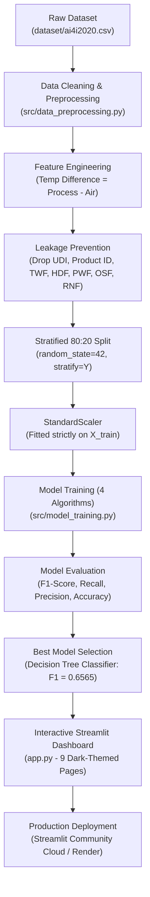

---

## Machine Learning Models & Methodology

To ensure transparent and syllabus-compatible evaluation, four classification algorithms were trained and benchmarked:

1. **Logistic Regression (`model1`):** Linear decision boundary with `class_weight="balanced"`.
2. **Decision Tree Classifier (`model2`):** Non-linear rule-based tree with `class_weight="balanced"`.
3. **K-Nearest Neighbors (`model3`):** Distance-based instance learning ($k=5$).
4. **Gaussian Naïve Bayes (`model4`):** Probabilistic model assuming conditional feature independence.

### Data Leakage Prevention Rules
* Target variable is strictly `Machine failure`.
* Identifiers (`UDI`, `Product ID`) and breakdown flags (`TWF`, `HDF`, `PWF`, `OSF`, `RNF`) were excluded before model training.
* `StandardScaler` was fitted strictly on `X_train` and merely transformed `X_test`.

---

## Dataset Description & Citation

The project utilizes the **AI4I 2020 Predictive Maintenance Dataset**, an industry benchmark reflecting milling machine telemetry.

* **Total Samples:** 10,000 observations
* **Target Variable:** `Machine failure` (`0 = Healthy`, `1 = Failure`)
* **License:** Creative Commons Attribution 4.0 International ([CC BY 4.0](https://creativecommons.org/licenses/by/4.0/))
* **Dataset Location:** `dataset/ai4i2020.csv`

### Data Dictionary

| Column Name | Data Type | Units / Range | Description |
|:---|:---:|:---:|:---|
| `UDI` | Integer | 1 – 10,000 | Row identifier (*Excluded from features*) |
| `Product ID` | String | L/M/H + serial | Serial number (*Excluded from features*) |
| `Type` | Categorical | L (60%), M (30%), H (10%) | Product quality grade: Low, Medium, High |
| `Air temperature [K]` | Float | 295.3 – 304.5 K | Ambient room air temperature |
| `Process temperature [K]` | Float | 305.7 – 313.8 K | Cutting process temperature |
| `Rotational speed [rpm]` | Integer | 1,168 – 2,886 rpm | Spindle rotational speed |
| `Torque [Nm]` | Float | 3.8 – 76.6 Nm | Torque delivered to cutting tool |
| `Tool wear [min]` | Integer | 0 – 253 min | Cumulative cutting tool operating time |
| `Machine failure` | Binary | 0 or 1 | Overall failure indicator (**Target**) |
| `TWF, HDF, PWF, OSF, RNF` | Binary | 0 or 1 | Failure modes (*Excluded to avoid leakage*) |

> **Citation:**
> Matzka, Stephan. (2020). *AI4I 2020 Predictive Maintenance Dataset*. UCI Machine Learning Repository. [https://doi.org/10.24432/C5HS5C](https://doi.org/10.24432/C5HS5C).

---

## Exploratory Data Analysis & Visualizations

### Objective 1: Machine Failure Distribution
* **Healthy Machines (0):** 9,661 units (**96.61%**)
* **Failed Machines (1):** 339 units (**3.39%**)
* *Takeaway:* Class imbalance makes accuracy deceptive; models must optimize for F1-score and Recall.

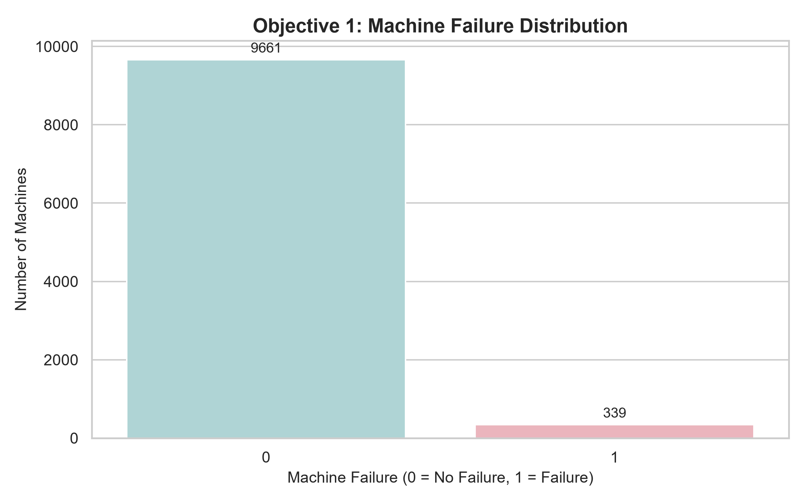

---

### Objective 2: Product Type & Failure Rates
* **Type L (Low Quality):** 6,000 units (60%) | Failure Rate: **3.92%** (235 failures)
* **Type M (Medium Quality):** 2,997 units (30%) | Failure Rate: **2.77%** (83 failures)
* **Type H (High Quality):** 1,003 units (10%) | Failure Rate: **2.09%** (21 failures)
* *Takeaway:* Type L variants experience nearly double the failure rate of Type H machines.

| Product Type Distribution | Failure Count by Product Type |
|:---:|:---:|
| 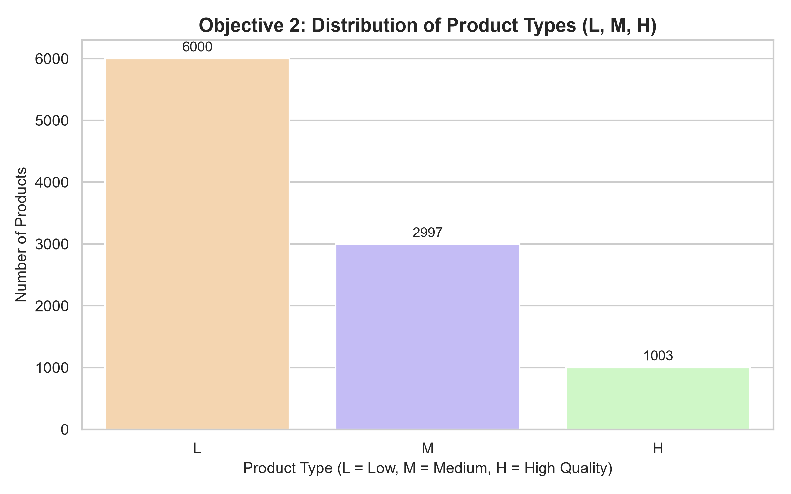 | 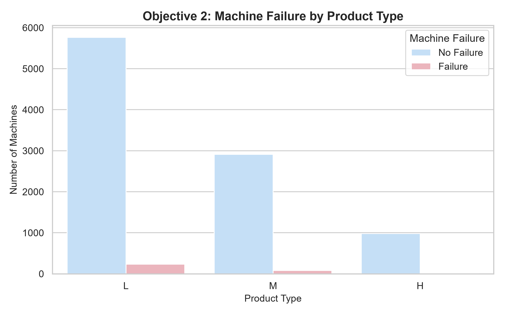 |

---

### Objective 3: Temperature Analysis & Thermal Dissipation
* **Non-Failed Machines Mean Delta:** **10.02 K**
* **Failed Machines Mean Delta:** **9.40 K**
* *Takeaway:* Constricted thermal dissipation gradients ($<9.0\text{ K}$) strongly correlate with Heat Dissipation Failure (HDF).

| Air Temperature Distribution | Temperature Difference vs Failure |
|:---:|:---:|
| 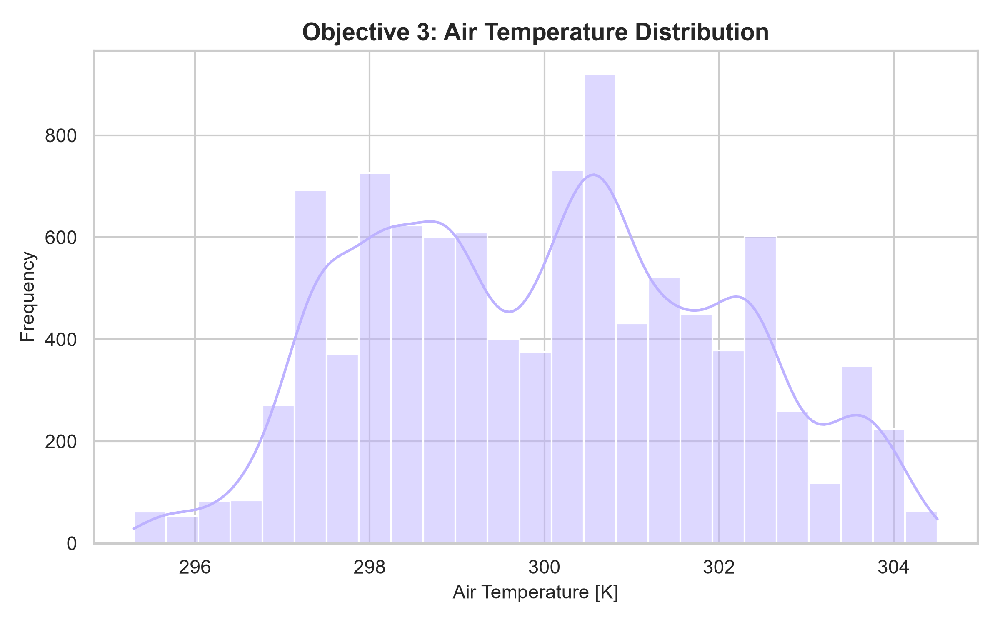 | 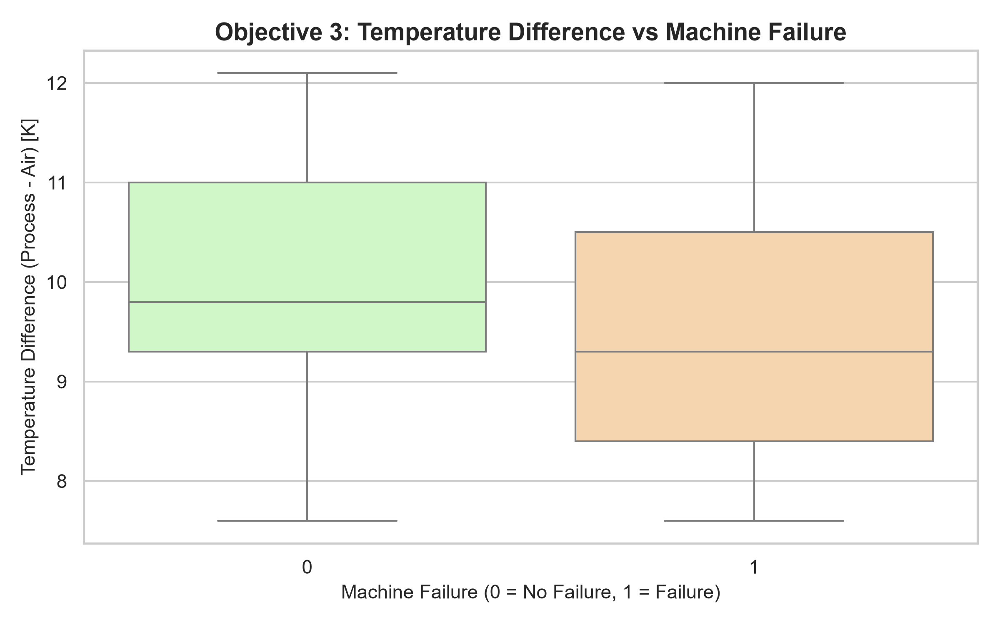 |

---

### Objective 4: Tool Wear, Torque, and Rotational Speed Dynamics
* **Tool Wear:** Healthy: **106.69 min** vs. Failing: **143.78 min** (peaks $>200\text{ min}$).
* **Torque:** Healthy: **39.63 Nm** vs. Failing: **50.17 Nm** (spikes $>55\text{ Nm}$).
* **Speed vs. Torque:** Inversely related ($r = -0.88$). Failures cluster in low-speed/high-torque (Overstrain) and high-speed/low-torque (Power failure) zones.

| Tool Wear vs Machine Failure | Torque vs Machine Failure |
|:---:|:---:|
| 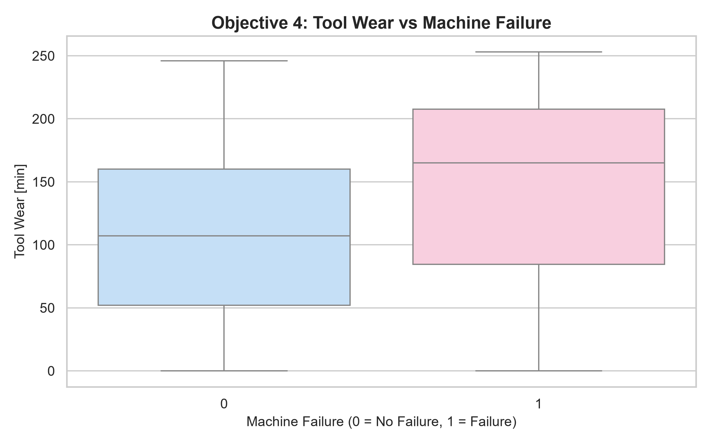 | 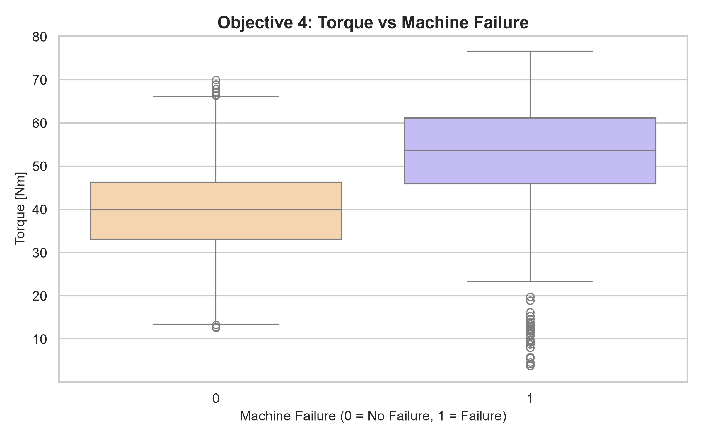 |

---

### Objective 5: Failure Mode Breakdown & Feature Correlation
* **Breakdown Counts:** HDF (**115**) > OSF (**98**) > PWF (**95**) > TWF (**46**) > RNF (**19**).
* *Takeaway:* Heat Dissipation and Overstrain represent over 62% of all breakdowns.

| Failure Mode Counts | Feature Correlation Heatmap |
|:---:|:---:|
| 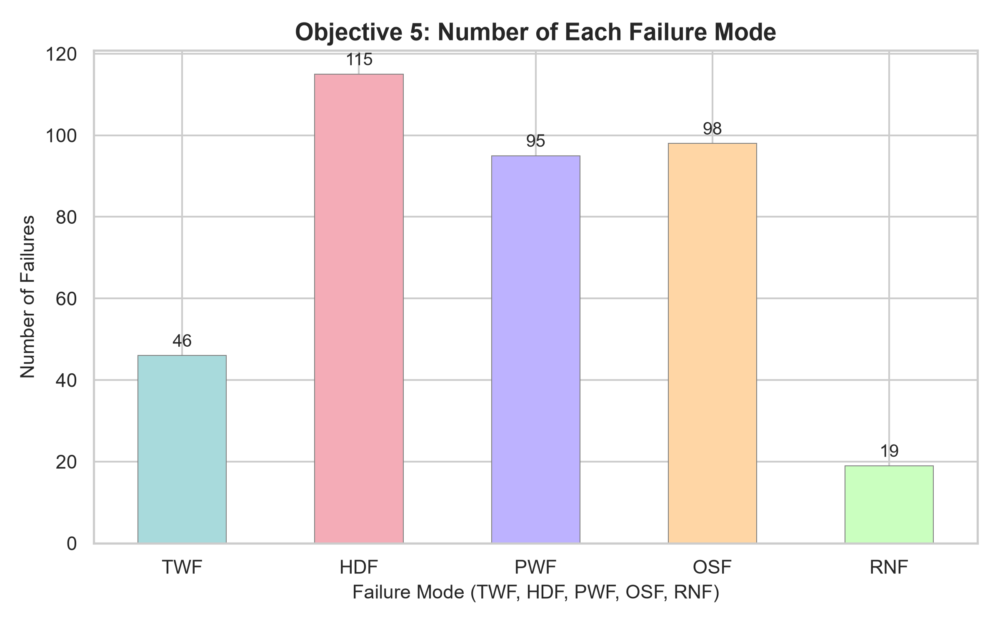 | 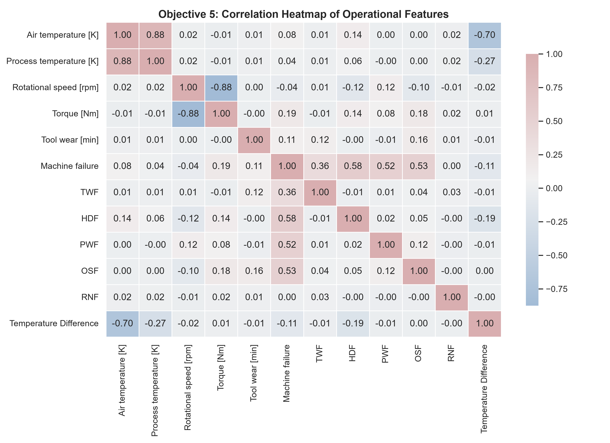 |

---

## Installation & Setup Instructions

### Prerequisites
* Python 3.10+ (tested on Python 3.12.5)
* Git

### Step-by-Step Installation

1. **Clone the repository:**
   ```bash
   git clone https://github.com/StutiJain4999/PredMaintain.git
   cd PredMaintain
   ```

2. **Create and activate a virtual environment:**
   ```powershell
   # Windows PowerShell
   python -m venv venv
   .\venv\Scripts\Activate.ps1

   # macOS / Linux
   python3 -m venv venv
   source venv/bin/activate
   ```

3. **Install dependencies:**
   ```bash
   pip install -r requirements.txt
   ```

---

## Project Directory Structure

```text
PredMaintain/
│
├── .streamlit/
│   └── config.toml                              # Dark-theme UI configuration for Streamlit
│
├── app.py                                       # Main Streamlit Dark-Theme Dashboard (9 Pages)
├── Predictive Maintenance of Industrial Machines.py  # Standalone Python script (All 5 Objectives & Step 12)
├── render.yaml                                  # Render Web Service Infrastructure Blueprint
├── requirements.txt                             # Pinned project dependencies
├── .gitignore                                   # Standard cache, bytecode, env exclusions
├── README.md                                    # Comprehensive project documentation
│
├── dataset/
│   └── ai4i2020.csv                             # AI4I 2020 Predictive Maintenance Dataset (10,000 rows)
│
├── src/                                         # Modular, maintainable application architecture
│   ├── __init__.py
│   ├── data_preprocessing.py                   # Data cleaning, feature engineering, and leakage prevention
│   ├── eda.py                                  # Dark-themed Plotly charts for analytical objectives
│   └── model_training.py                       # 4 ML models training, evaluation, and live inference engine
│
├── plots/                                       # 14 high-resolution visualizations (300 DPI)
│   ├── 01_machine_failure_distribution.png
│   ├── 02_product_type_distribution.png
│   ├── 03_failure_by_product_type.png
│   ├── 04_air_temperature_distribution.png
│   ├── 05_temperature_difference_vs_failure.png
│   ├── 06_tool_wear_vs_failure.png
│   ├── 07_torque_vs_failure.png
│   ├── 08_failure_type_counts.png
│   ├── 09_correlation_heatmap.png
│   ├── 10_model_accuracy_comparison.png
│   ├── 11_model_f1_score_comparison.png
│   ├── 12_best_model_confusion_matrix.png
│   ├── 13_decision_tree_feature_importance.png
│   └── final_decision_tree.png                  # Full decision tree architecture plot (Levels 1–3)
│
└── results/                                     # Machine-generated reports & metrics
    ├── model_comparison.csv                     # Metrics summary table (Accuracy, Precision, Recall, F1)
    ├── classification_report.txt                # Precision, recall, f1, and confusion matrix
    └── project_summary.txt                      # Detailed analysis summary of all 5 objectives
```

---

## How to Run the Application Locally

### 1. Launch the Streamlit Interactive Dashboard (Recommended)

```bash
streamlit run app.py
```
Open **`http://localhost:8501`** in your browser.

### 2. Run the Standalone Python Batch Script

To regenerate all 14 high-resolution plots and export metric files:

```bash
python "Predictive Maintenance of Industrial Machines.py"
```

To run in automated/headless mode (skipping interactive pop-up windows):
```powershell
# Windows PowerShell
[Environment]::SetEnvironmentVariable('SHOW_PLOTS', '0'); python "Predictive Maintenance of Industrial Machines.py"

# macOS / Linux
SHOW_PLOTS=0 python "Predictive Maintenance of Industrial Machines.py"
```

---

## How to Use the Application

The dashboard contains 9 dedicated dark-themed pages accessible via the sidebar navigation:

1. **📊 Dashboard Overview:** Executive health condition summary, real-time KPI metrics, operational scatter charts, and class distribution donut plots.
2. **🔍 Data Exploration:** Interactive tabular inspection, column filtering by product type & health status, statistical summaries, correlation heatmap, and instant **CSV export**.
3. **🎯 Five Objectives:** In-depth interactive exploration of Objectives 1 through 5 with dark-themed Plotly charts and data-driven findings.
4. **🤖 Machine Learning Models:** Comprehensive benchmark table with execution times (ms), Accuracy, Precision, Recall, and F1-score across all 4 algorithms.
5. **📈 Model Evaluation:** Interactive confusion matrices, classification reports, and deep-dive discussions on imbalanced data.
6. **🌳 Decision Tree Visualization:** Interactive tree architecture viewer with depth slider (levels 1–5), node threshold diagnostics, Gini impurity metric, and high-resolution PNG download.
7. **🔮 Predictions:** Interactive telemetry simulator allowing users to enter sensor parameters, test failure probability, and receive preventive action recommendations.
8. **💡 Insights & Recommendations:** Practical industrial maintenance thresholds (tool wear limits, torque cutoffs, thermal buffers).
9. **ℹ️ Dataset Information:** UCI ML repository schema, feature descriptions, and dataset attribution.

---

## Model Evaluation Metrics & Results

All models were evaluated on the held-out test partition (**2,000 unseen machine records**) using a stratified 80:20 split (`random_state=42`):

| Model | Accuracy | Precision | Recall | F1 Score | Training Time |
|:---|:---:|:---:|:---:|:---:|:---:|
| **Logistic Regression** | 82.60% | 14.29% | **82.35%** | 0.2435 | ~16 ms |
| **Decision Tree (Selected Best)** | **97.75%** | **68.25%** | **63.24%** | **0.6565** | ~14 ms |
| **K-Nearest Neighbors (KNN)** | 97.50% | 87.50% | 30.88% | 0.4565 | ~2 ms |
| **Gaussian Naïve Bayes** | 95.90% | 29.41% | 14.71% | 0.1961 | ~3 ms |

*Actual data exported to `results/model_comparison.csv`.*

### Metric Comparison Charts

| Accuracy Comparison | F1-Score Comparison |
|:---:|:---:|
| 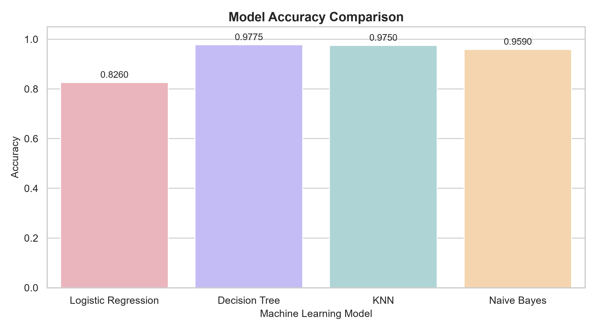 | 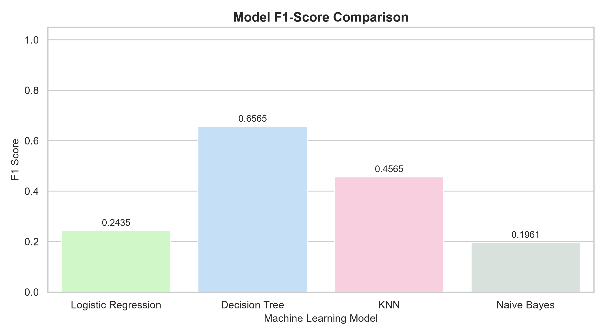 |

---

### Best Model Selection: **Decision Tree Classifier**

* **Overall Accuracy:** **97.75%**
* **Precision:** **68.25%**
* **Recall:** **63.24%**
* **F1-Score:** **0.6565** (Highest across all evaluated algorithms)

#### Why F1-Score Governs Over Accuracy:
* A baseline model predicting "No Failure" 100% of the time achieves **96.61% accuracy** but misses every single failure.
* **Cost of False Negatives (Missed Breakdowns):** Broken tooling, scrap workpieces, motor burnouts, and catastrophic downtime.
* **Cost of False Positives (False Alarms):** A quick 5-minute visual inspection during a shift change.
* **Conclusion:** The Decision Tree achieves the optimal balance between detecting true breakdowns while avoiding excessive false alarms.

### Confusion Matrix of Best Model (2,000 Test Machines)

| Metric | Normal Operation (0) | Machine Failure (1) |
|:---|:---:|:---:|
| **Actual Normal (0)** | **TN = 1,912** | **FP = 20** |
| **Actual Failure (1)** | **FN = 25** | **TP = 43** |

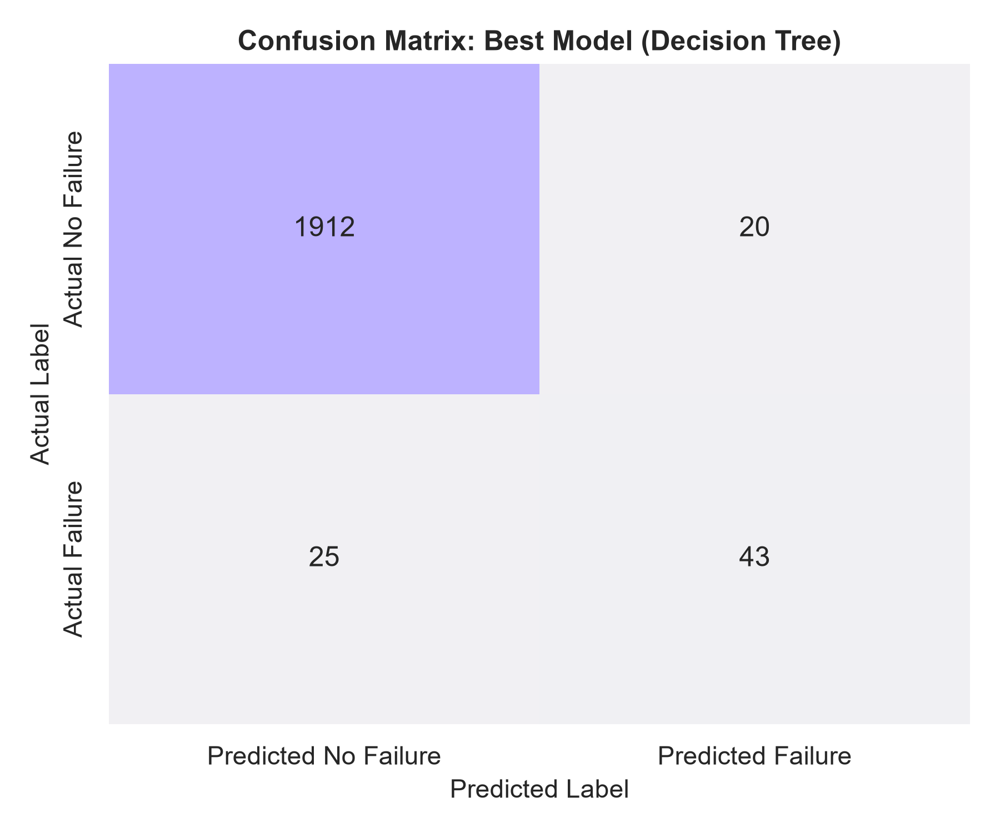

### Feature Importance (Decision Tree)

| Feature | Importance Score | Percentage Contribution |
|:---|:---:|:---:|
| **Rotational speed [rpm]** | 0.3355 | **33.55%** |
| **Torque [Nm]** | 0.3085 | **30.85%** |
| **Tool wear [min]** | 0.2547 | **25.47%** |
| **Temperature Difference** | 0.0546 | **5.46%** |
| **Air temperature [K]** | 0.0210 | **2.10%** |
| **Process temperature [K]** | 0.0163 | **1.63%** |
| **Type_L (Low Quality)** | 0.0049 | **0.49%** |
| **Type_M (Medium Quality)** | 0.0045 | **0.45%** |

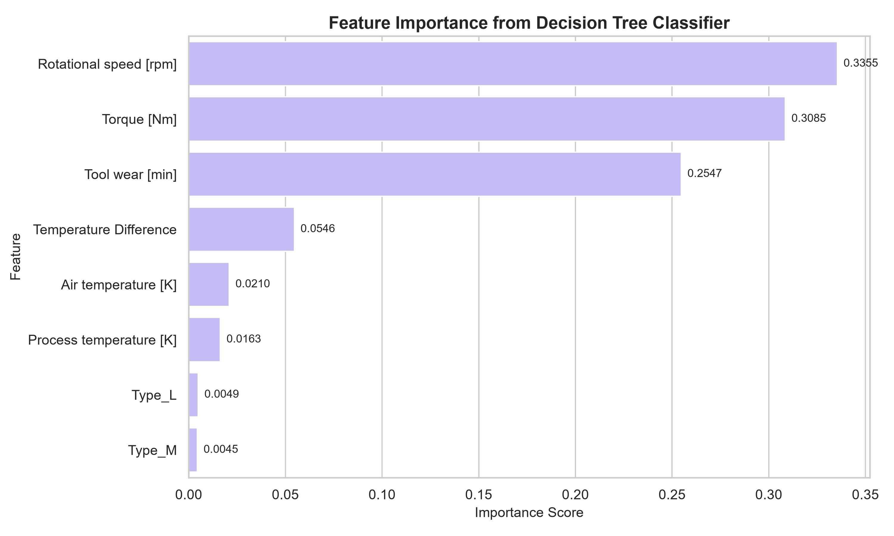

---

## Final Decision Tree Architecture

The full architecture of the trained Decision Tree Classifier (`model2`), showing levels 1 through 3 with filled rounded nodes and a blue/orange palette:

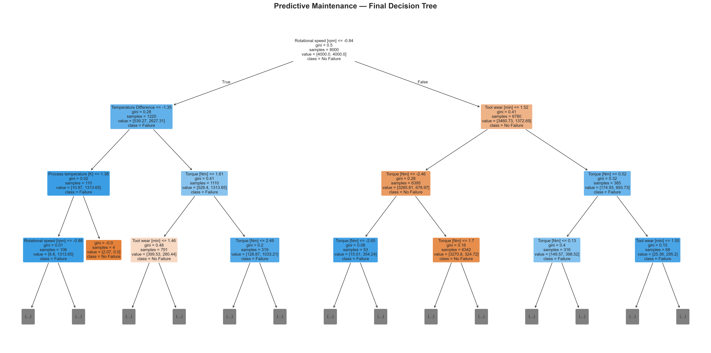

---

## Actionable Maintenance Recommendations

1. **Automated Tool Wear Retraction:** Enforce cutting tool changes once cumulative wear reaches **180 minutes**, well prior to failure escalation at 240+ minutes.
2. **Torque Limiter Cutoffs:** Program CNC spindle interlocks to throttle feed rates whenever continuous torque surpasses **55 Nm**.
3. **Thermal Gradient Maintenance:** Maintain machine shop HVAC cooling to ensure a minimum **10 K thermal gradient** between cutting process heat and ambient room temperature.
4. **Targeted Inspections for Variant L:** Increase inspection frequencies by 1.5x on production lines running Type L workpieces.

---

## Limitations

> [!WARNING]
> The AI4I 2020 Predictive Maintenance Dataset is a **synthetic benchmark dataset** generated from physical differential equations. While it accurately reflects theoretical kinematics (power formulas, tool wear curves, and thermal diffusion), commercial factories experience extraneous factors such as operator technique, cutting fluid degradation, electrical harmonic noise, and tool geometry variances. Real-world implementation requires validation using on-site historical vibration and acoustic data.

---

## Future Enhancements

1. **Vibration Sensor Ingestion:** Integrate high-frequency accelerometer streams for early bearing fault detection.
2. **Multi-Class Breakdown Classification:** Train hierarchical secondary models to predict the exact breakdown mode (`TWF`, `HDF`, `PWF`, `OSF`).
3. **Automated Maintenance Webhooks:** Dispatch automated Slack, SMS, or Jira work-order tickets when high failure probabilities are flagged.
4. **Remaining Useful Life (RUL) Estimation:** Transition from binary classification to continuous regression modeling for component lifespan forecasting.

---

## Author Information

* **Author:** Stuti Jain
* **GitHub:** [@StutiJain4999](https://github.com/StutiJain4999)
* **Project Repository:** [https://github.com/StutiJain4999/PredMaintain](https://github.com/StutiJain4999/PredMaintain)

---

## License & Acknowledgements

* **Dataset Citation:** Stephan Matzka, *AI4I 2020 Predictive Maintenance Dataset*, School of Engineering - Technology and Life, Hochschule für Technik und Wirtschaft Berlin, 2020. Released under Creative Commons Attribution 4.0 International ([CC BY 4.0](https://creativecommons.org/licenses/by/4.0/)).
* **Frameworks & Libraries:** Streamlit, Scikit-Learn, Plotly, Pandas, NumPy, Matplotlib, Seaborn.
